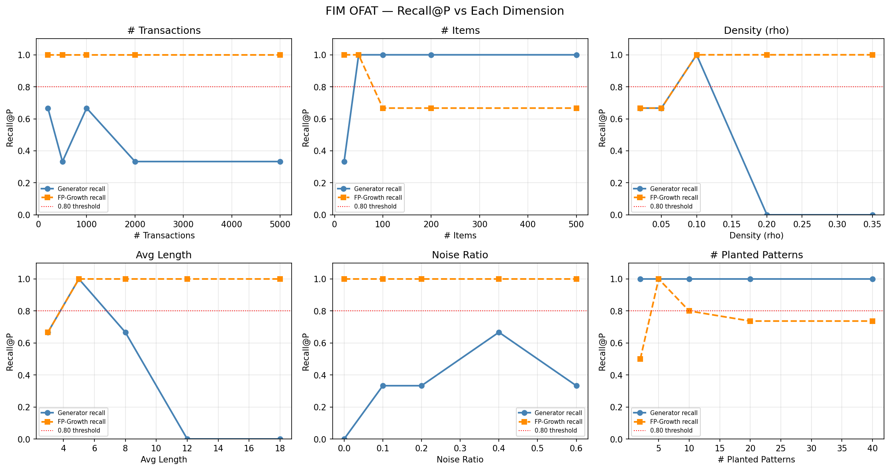
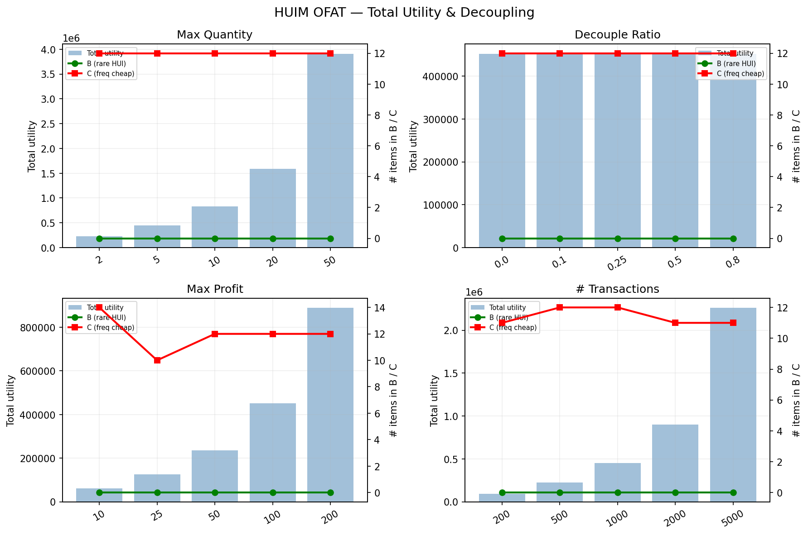

# Projet 2 — Générateur de données transactionnelles synthétiques (FIM / HUIM)

Générateur paramétrable de bases de transactions destinées à évaluer les algorithmes de
**Frequent Itemset Mining** (FP-Growth, Eclat…) et de **High-Utility Itemset Mining** (FHM, IHUP…).

Le générateur produit des données réalistes :

- popularité des items en **loi de puissance** (Zipf) ;
- longueurs de transactions **log-normales** (asymétrie à droite) ;
- **motifs implantés** (ground truth) avec un support cible, pour mesurer le rappel des algorithmes ;
- pour le HUIM : **profits unitaires** en loi de puissance, **quantités** par item et utilité par transaction.

Le rapport complet est dans [`rapport_projet2.pdf`](rapport_projet2.pdf).

## Structure

```
projet2/
├── app.py                  # Interface web Flask (génération, validation, expériences, résultats, LLM)
├── generator/
│   ├── generate.py         # FIMGenerator / HUIMGenerator + CLI
│   ├── validate.py         # Contrôles structurels, statistiques, ground truth, HUIM
│   ├── config_fim_example.json
│   └── config_huim_example.json
├── experiments/
│   ├── ofat.py             # Expériences OFAT (FIM : 6 dimensions, HUIM : 4 dimensions + seuil δ)
│   ├── spmf_runner.py      # Comparaison FP-Growth vs Eclat, FHM vs IHUP
│   └── plot.py             # Génère les figures dans results/figures/
├── llm/
│   ├── prompts.py          # 4 stratégies de prompt (minimal, narratif, few-shot, itératif)
│   ├── llm_generator.py    # Génération via Ollama (local) ou HuggingFace
│   ├── compare.py          # Générateur classique vs LLM (+ rappel SPMF)
│   └── plot_llm.py
├── datasets/llm/           # Datasets produits par le LLM (non reproductibles, donc versionnés)
├── results/
│   ├── tables/             # Résultats JSON des expériences
│   └── figures/            # Figures PNG
├── templates/              # Templates HTML de l'interface
├── spmf.jar                # Bibliothèque SPMF (GPL v3) — https://www.philippe-fournier-viger.com/spmf/
└── rapport_projet2.pdf
```

## Prérequis

- **Python 3.10+**
- **Java 8+** (uniquement pour les expériences qui appellent `spmf.jar`)
- Optionnel : [Ollama](https://ollama.com) ou un token HuggingFace pour la partie LLM

```bash
python -m venv .venv
# Windows : .venv\Scripts\activate    |    Linux/macOS : source .venv/bin/activate
pip install -r requirements.txt
```

## Utilisation

### Interface web

```bash
python app.py
```

Puis ouvrir <http://localhost:5001>. Variables d'environnement optionnelles : `PORT`, `FLASK_DEBUG=1`.

### Générer un dataset (CLI)

```bash
# FIM
python generator/generate.py generator/config_fim_example.json -o datasets/fim/exemple -p exemple -s 42

# HUIM (détecté automatiquement grâce à la clé "huim" de la config)
python generator/generate.py generator/config_huim_example.json -o datasets/huim/exemple -p exemple -s 42
```

Sorties : `<prefix>.dat` (format SPMF), `<prefix>_groundtruth.json` et, en HUIM, `<prefix>_profits.txt`.

Format HUIM d'une ligne : `items : utilité_transaction : quantités`, par exemple `3 7 12:145:2 1 4`.

### Valider un dataset

```bash
python generator/validate.py datasets/fim/exemple/exemple.dat generator/config_fim_example.json
python generator/validate.py datasets/huim/exemple/exemple.dat generator/config_huim_example.json --huim --json rapport.json
```

Le validateur vérifie :

| Catégorie | Contrôles |
|---|---|
| Structure | nombre de transactions, vocabulaire, longueur moyenne, densité (avec tolérances) |
| Statistiques | exposant α de la loi de puissance et R², asymétrie des longueurs |
| Ground truth | support mesuré vs cible de chaque motif implanté, rappel ≥ 0,80 |
| HUIM | intégrité de la table des profits, règle 80/20, table de découplage fréquence/utilité |

### Expériences (Java requis)

```bash
cd experiments
python ofat.py          # -> results/tables/ofat_fim.json, ofat_huim.json, reproducibility.json
python spmf_runner.py   # -> results/tables/spmf_fim_comparison.json, spmf_huim_comparison.json
python plot.py          # -> results/figures/*.png
```

### Comparaison avec un LLM

```bash
cd llm
# Ollama (local, gratuit)
ollama pull mistral
python compare.py --backend ollama --model mistral

# HuggingFace (le token est lu depuis la variable HF_TOKEN)
export HF_TOKEN=hf_xxx          # Windows PowerShell : $env:HF_TOKEN="hf_xxx"
python compare.py --backend hf --model meta-llama/Llama-3.3-70B-Instruct

# Recalculer uniquement le rappel SPMF sur les datasets LLM existants
python compare.py --skip-llm

python plot_llm.py
```

> Ne commitez jamais de token. Utilisez un fichier `.env` (ignoré par git) en vous basant sur [`.env.example`](.env.example).

## Résultats

Les tableaux JSON sont dans [`results/tables/`](results/tables/) et les figures dans [`results/figures/`](results/figures/).
L'analyse détaillée se trouve dans le [rapport](rapport_projet2.pdf).

<p align="center">
  
  
</p>
